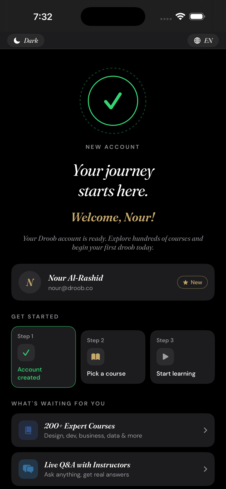
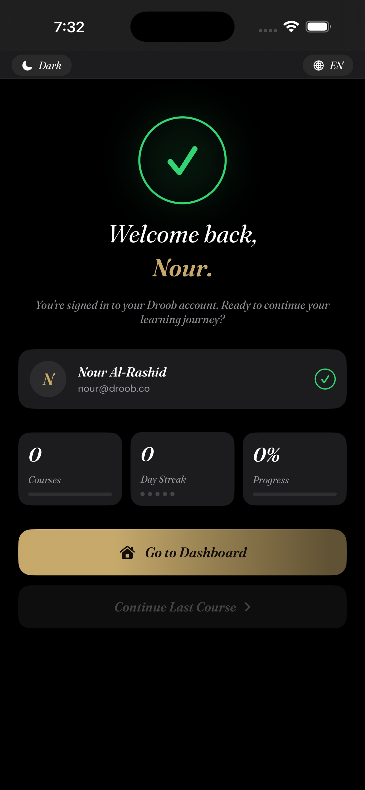
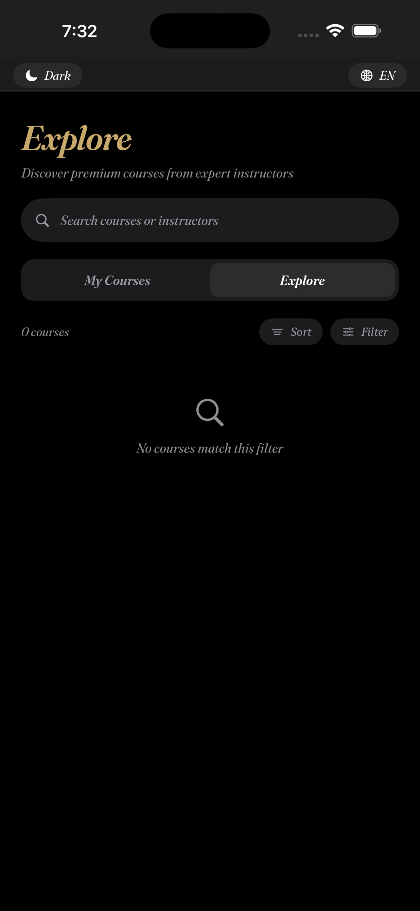
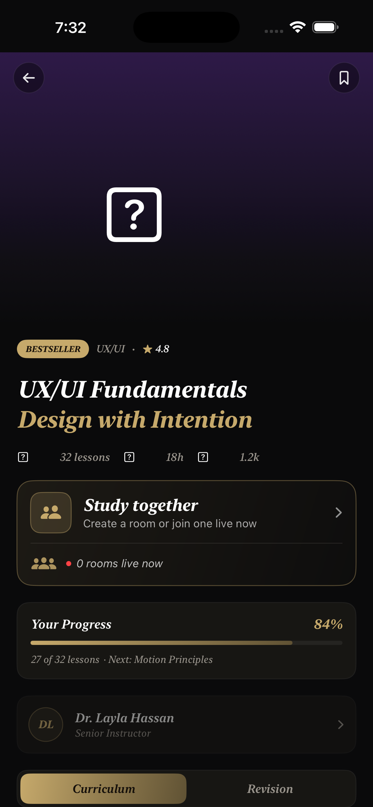
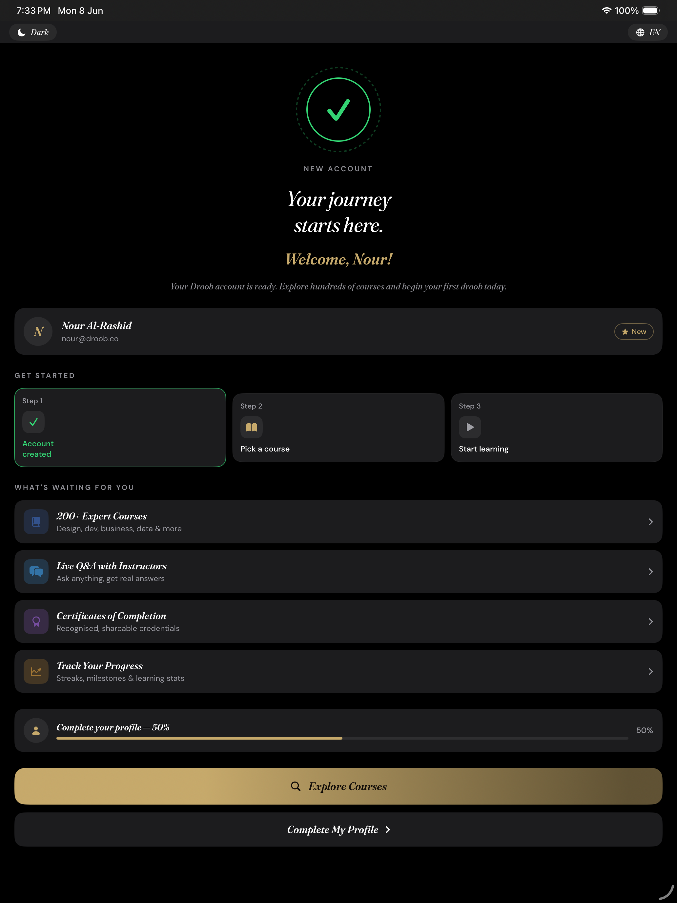
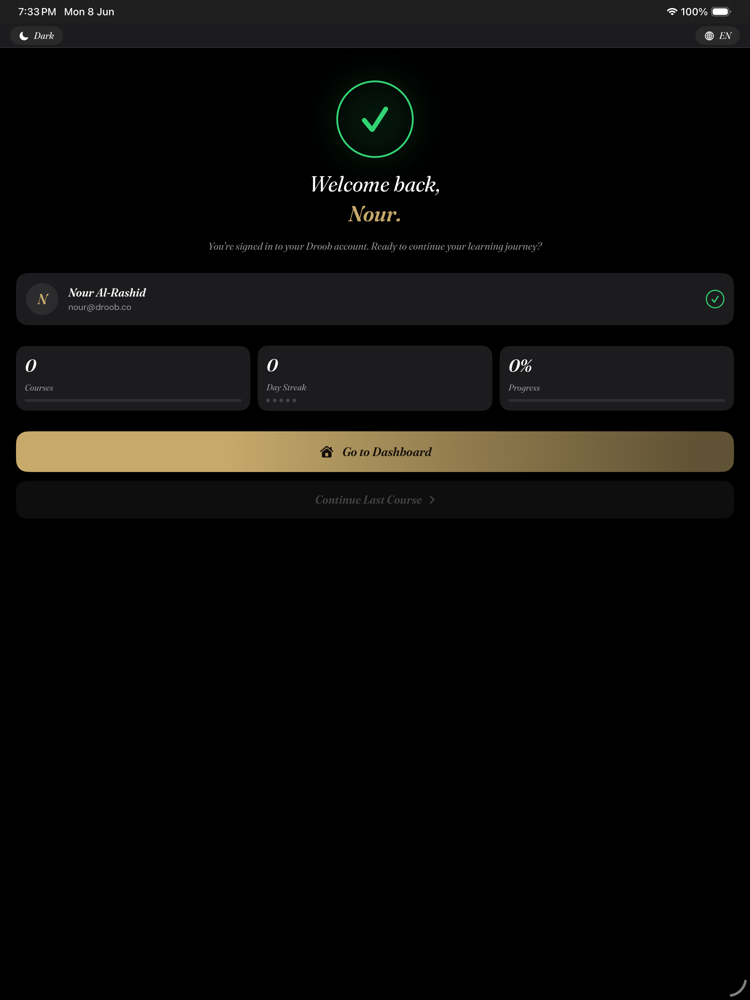
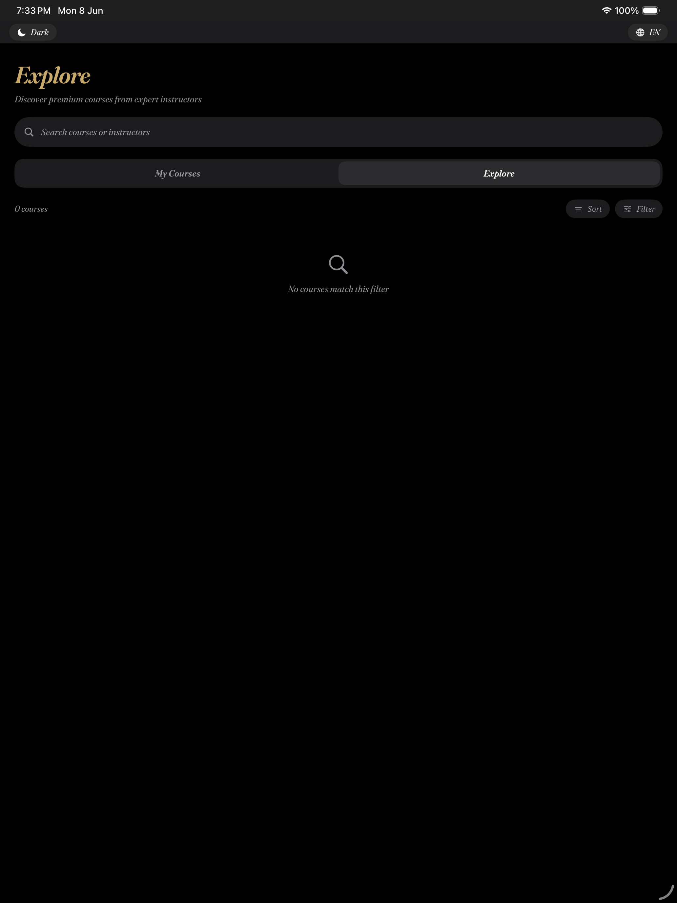
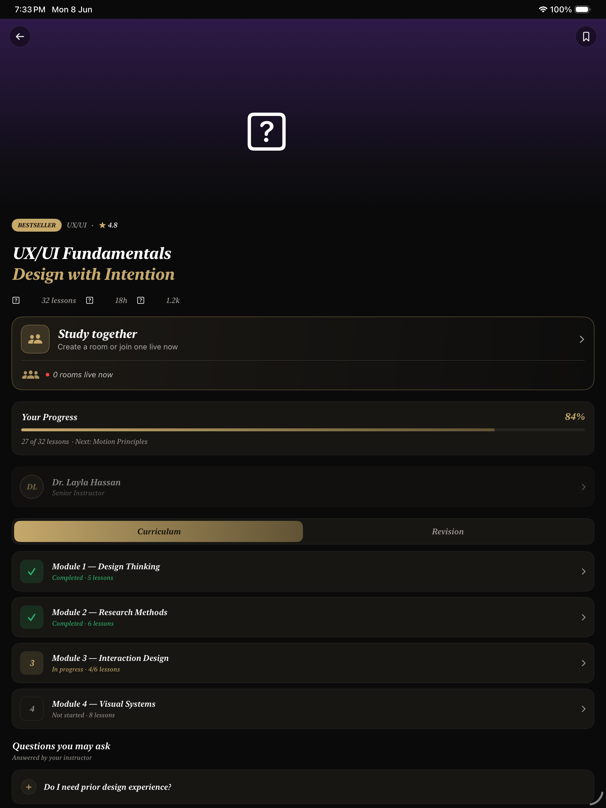

<div align="center">


# Droob Student

**Native SwiftUI student app for the Droob learning platform: courses, HLS video lessons and a streaming AI tutor, in English and Arabic.**


-2EA043)


</div>

## Screenshots

| Welcome | Welcome back | My courses | Course detail |
|---|---|---|---|
|  |  |  |  |

<details>
<summary>iPad screenshots</summary>

| Welcome | Welcome back | My courses | Course detail |
|---|---|---|---|
|  |  |  |  |

</details>

## Features

- **Catalog**: paginated course list with search, sort and filter, plus course detail
- **Subscribe**: subscribe sheet with confirmation
- **Lessons**: lesson list with an HLS video player (AVKit)
- **AI Tutor and Ask Droob AI**: streaming chat over Server-Sent Events, with sources and feedback
- **Quizzes, study rooms and messages** for learning with others
- **Profile**: user info, English/Arabic toggle with full RTL layout, dark/light mode, logout
- **Deep links**: `droob://courses/<courseId>`

## Requirements

- Xcode 15+
- iOS 16+ simulator or device
- Swift 5.9

## Setup

1. Clone the repo.
2. Set `DROOB_API_BASE_URL` — either:
   - Edit the build setting in Xcode (DroobStudent target → Build Settings → search `DROOB_API_BASE_URL`), or
   - Pass as an environment variable: `DROOB_API_BASE_URL=https://your-backend.example.com xcodebuild ...`
3. Open `DroobStudent.xcodeproj` in Xcode 15+.
4. Select the `DroobStudent` scheme and an iPhone 16+ simulator.
5. Press ⌘R to build and run.

## Build from CLI

```bash
DROOB_API_BASE_URL=https://your-backend.example.com \
  xcodebuild \
    -scheme DroobStudent \
    -destination 'platform=iOS Simulator,name=iPhone 15' \
    build
```

## Architecture

```
MVVM + Repository, feature-folder layout
├── Core/
│   ├── Networking/   APIClient (async/await), AuthInterceptor (actor), SSEParser
│   ├── Auth/         TokenStore (Keychain), AuthSession (state machine)
│   ├── Localization/ L10n typed keys, en/ar .strings
│   └── DesignSystem/ BrandColors, Typography, DroobButton
└── Features/
    ├── Auth/         Login + Register
    ├── Catalog/      Course list (paginated) + Course detail
    ├── Subscribe/    Subscribe sheet with confirmation + HUD
    ├── MyCourses/    Enrolled courses list
    ├── Lesson/       Lesson list + HLS video player (AVKit)
    ├── AiTutor/      Streaming SSE chat + sources + feedback
    └── Profile/      User info + EN/AR language toggle + logout
```

## Key implementation details

- **Auth:** Tokens stored in Keychain with `kSecAttrAccessibleAfterFirstUnlockThisDeviceOnly`. On 401, `AuthInterceptor` (actor) refreshes once and replays; expired refresh kicks to Login.
- **SSE:** `APIClient.bytesStream` uses `URLSession.bytes(for:)` line-by-line; `SSEParser.stream(from:)` returns `AsyncStream<TutorEvent>`.
- **Pagination:** Spring `Page<T>` decoded from `content`, `totalElements`, `totalPages`, `number`, `size`.
- **Deep links:** `droob://courses/<courseId>` handled in `DroobStudentApp`, forwarded to `CatalogListView` via `AuthSession.pendingDeepLinkCourseId`.
- **Locale:** `@AppStorage("appLocale")` drives both `Environment(\.layoutDirection)` (RTL for `ar`) and `L10n` string lookup.

## Running tests

```bash
xcodebuild test \
  -scheme DroobStudentTests \
  -destination 'platform=iOS Simulator,name=iPhone 15'
```

## Demo seed data

| Course | ID |
|---|---|
| ML Fundamentals | `00000000-0000-0000-0000-000000000021` |
| Arabic Mastery | `00000000-0000-0000-0000-000000000022` |
| React Dev | `00000000-0000-0000-0000-000000000023` |
| Digital Marketing | `00000000-0000-0000-0000-000000000024` |

Deep link example: `droob://courses/00000000-0000-0000-0000-000000000021`

## Firebase config (not in this repo)

`DroobStudent/Resources/GoogleService-Info.plist` is git-ignored because it carries API keys.
Download it from your Firebase project, place it at that path, and set the reversed client id
URL scheme in `DroobStudent/Info.plist` (`com.googleusercontent.apps.YOUR-IOS-CLIENT-ID`).
Without it, push notifications and Google sign-in are disabled.
